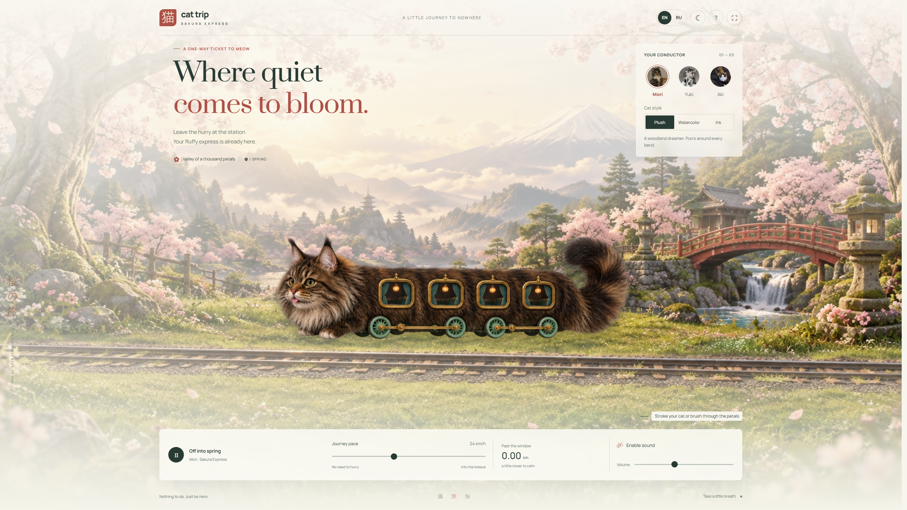

# 🌸 Sakura Express

**A calm, interactive cat train journey through a spring garden.** Choose a feline conductor, watch petals drift by, adjust the pace, and take a short breathing break. This is a self-contained static web experience built with HTML, CSS, and vanilla JavaScript.



[Open the full-resolution desktop screenshot](screenshots/sakura-express-desktop.png) (2560 × 1440 PNG).

## What you can do

- **Meet three conductors:** Mori, Yuki, and Aki, each with a description and a playful reaction when petted.
- **Change the look:** switch the cat artwork between plush, watercolor, and ink styles.
- **Set the mood:** toggle day and night, pause or resume the train, and adjust its speed.
- **Interact with the scene:** move the pointer through the petals to stir them, or click and stroke the cat train to pet your conductor.
- **Listen or relax in silence:** enable the browser-generated soundtrack and adjust its volume. Sound starts only after user interaction and depends on browser audio support.
- **Take a breathing break:** open the guided breathing dialog from the footer.
- **Use it your way:** English and Russian interface options, responsive layout, fullscreen control where supported, keyboard shortcuts, and reduced-motion support.

## Controls

| Action | Control |
| --- | --- |
| Pause or resume | Journey button or `Space` |
| Toggle sound | Sound button or `M` |
| Switch day and night | Moon/sun button or `N` |
| Change speed or volume | Sliders in the control panel |
| Choose a cat or art style | Buttons in the conductor panel |
| Pet the cat | Click or stroke the train |
| Open help or breathing guide | `?` button or footer breathing button |

Keyboard shortcuts work when focus is outside buttons, links, and form controls, and when no dialog is open.

## Run locally

No package install or build step is needed. Open `index.html` in a modern browser, or serve the folder over HTTP:

```sh
python -m http.server 8000
```

Then open <http://localhost:8000>. The Python command is only an optional local static server; the application itself is written in HTML, CSS, and JavaScript.

## Deploy

Upload `index.html` together with the entire `assets/` directory to any static web host. Keep their relative paths intact. There is no backend, account system, or API configuration in this project.

The page requests **Manrope** and **Prata** from Google Fonts. Internet access is needed for those fonts; if unavailable, the browser uses its fallback fonts. The illustrations and application code are local files. Preferences such as language, cat, style, theme, speed, and volume are stored in the browser under the `cat-trip-preferences` localStorage key; they are specific to that browser and site origin and can be cleared with browser storage.

## Project files

```text
index.html             Interface, styles, and JavaScript
assets/                Garden, conductor, and train artwork
README.md              Project guide
LICENSE                MIT license for source code
MEDIA_RIGHTS.md        Artwork and media rights notice
```

## License and artwork

The **source code** is licensed under [MIT](LICENSE). The images in `assets/` are **not** granted under MIT; see [MEDIA_RIGHTS.md](MEDIA_RIGHTS.md) before copying, modifying, or redistributing them separately. Third-party fonts are delivered by Google Fonts under their own applicable licenses.
